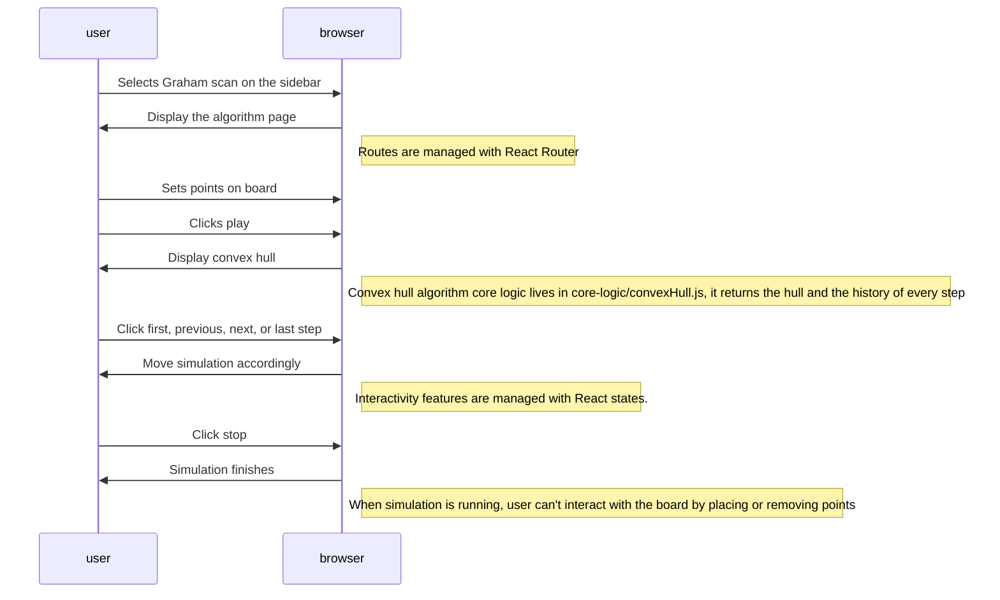

# Interactive Convex Hull Visualizer

- From scratch implementation, including computational geometry, visualization, and interactivity
- 0 lines of code written by AI

## Overview

The Convex Hull algorithm takes as input a set of points and finds the smallest convex sub-set that contains all the points.

This is an important algorithm in different areas such as image processing, route planning, and object modeling. It is also widely used in competitive programming.

The project is organized as a visualizer of computational geometry algorithms, where each algorithm has its own page. Currently, the Graham Scan algorithm is available.


## Features

- User can navigate between algorithms using the sidebar, which can be opened and closed with the toggle button.
- User can add points on the board, which is drawn as a cartesian plane with a grid and x, y axes.
- When clicking Play, the application shows the result of the Graham Scan algorithm with the given set of points.
- User can see the algorithm step by step using the playback controls in the panel next to the board (first step, previous step, next step, last step).
- User can click Stop to clear the simulation and provide a different set of points.
- Duplicated points are ignored, and at least 3 points are needed to run the algorithm.


## Architecture

- Frontend was implemented using React 19 + React Router + HTML Canvas API, bundled with Vite.
- Computational geometry implemented with Javascript in `core-logic/convexHull.js`, independent from the frontend.
- Each algorithm page lives in `visualizer-frontend/src/algorithm-pages/`, and shared UI (sidebar, playback icons) lives in `visualizer-frontend/src/components/`.
- Here is an overview of how the visualization is implemented:




## Run the project

Run locally typing the following in your terminal:

```bash
git clone https://github.com/LestathRiveraD/Interactive-Convex-Hull-Visualizer.git
cd Interactive-Convex-Hull-Visualizer/visualizer-frontend
npm i
npm run dev
```

## References

For reference, I'll leave the main sources of information while making this project:

- Convex hull construction - Algorithms for Competitive Programming. (2024). Cp-Algorithms.Com. https://cp-algorithms.com/geometry/convex-hull.html
- Stable Sort. (2020). Convex Hull Algorithm - Graham Scan and Jarvis March tutorial [Video]. YouTube. https://www.youtube.com/watch?v=B2AJoQSZf4M

## Credits

- Playback and sidebar icons from Font Awesome Free 6.7.2 by Fonticons, Inc., licensed under CC BY 4.0. See `visualizer-frontend/public/licenses/fontawesome-free.txt`.
